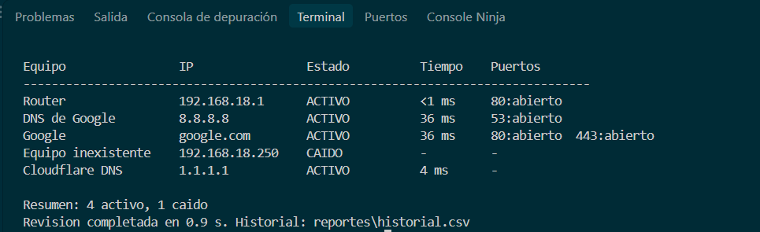
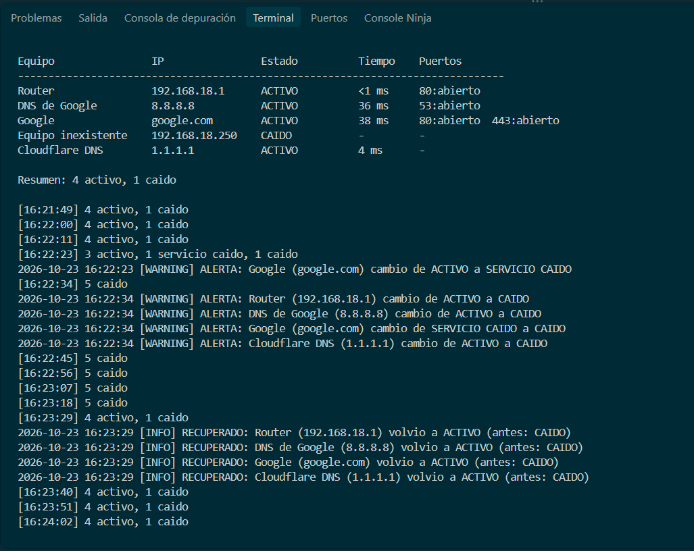
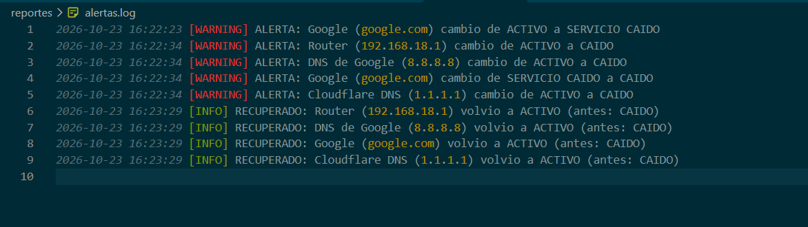
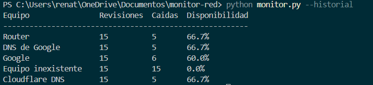

# Monitor de Red

Herramienta de consola en Python que verifica la disponibilidad de equipos y servicios
de una red (ping y puertos TCP), guarda un historial en CSV, calcula la disponibilidad
de cada equipo y registra alertas cuando un equipo cambia de estado.

## Funcionalidades
- Verificación por ping con medición del tiempo de respuesta
- Verificación de puertos TCP por equipo (por ejemplo web, DNS)
- Cuatro estados: ACTIVO, LENTO, SERVICIO CAIDO y CAIDO
- Revisión en paralelo con hilos: el tiempo total no crece con cada equipo caído
- Historial en CSV, compatible con Excel
- Cálculo de disponibilidad acumulada por equipo
- Monitoreo continuo con alertas y recuperaciones registradas en un log
- Sin dependencias externas: solo biblioteca estándar de Python

## Requisitos
Python 3.8 o superior. Funciona en Windows y Linux.

## Uso
```bash
git clone https://github.com/Renatto10/monitor-red.git
cd monitor-red

python monitor.py                # una revision
python monitor.py --cada 30      # monitoreo continuo cada 30 segundos (Ctrl+C para detener)
python monitor.py --historial    # disponibilidad acumulada por equipo
```

## Configuración
Los equipos se definen en `equipos.json`. La lista de `puertos` es opcional.
```json
[
    {"nombre": "Router", "ip": "192.168.1.1", "puertos": [80]},
    {"nombre": "Google", "ip": "google.com", "puertos": [80, 443]},
    {"nombre": "Equipo simple", "ip": "1.1.1.1"}
]
```
   Las IP del archivo de ejemplo corresponden a una red doméstica: ajústalas a tu red.
   "Equipo inexistente" se incluye a propósito para mostrar el estado CAIDO.
## Estados
| Estado | Significado |
|---|---|
| ACTIVO | Responde ping y sus puertos están abiertos |
| LENTO | Responde, pero supera el límite de tiempo (100 ms) |
| SERVICIO CAIDO | Responde ping, pero un puerto esperado está cerrado |
| CAIDO | No responde ping |

## Ejemplo de salida
```
Equipo                IP                Estado          Tiempo    Puertos
--------------------------------------------------------------------------------
Router                192.168.18.1      ACTIVO          <1 ms     80:abierto
DNS de Google         8.8.8.8           ACTIVO          38 ms     53:abierto
Google                google.com        ACTIVO          37 ms     80:abierto  443:abierto
Equipo inexistente    192.168.18.250    CAIDO           -         -

Resumen: 3 activo, 1 caido
```

## Capturas

### Revisión de la red



### Monitoreo con alertas y recuperación
Al perder la conexión, Google pasa primero a SERVICIO CAIDO (responde ping pero su puerto
falla) y luego a CAIDO; al reconectar, cada equipo registra su recuperación.



El mismo evento queda guardado en `reportes/alertas.log`:



### Disponibilidad acumulada


## Archivos generados
- `reportes/historial.csv`: una fila por equipo en cada revisión
- `reportes/alertas.log`: alertas y recuperaciones con fecha y hora

## Pruebas realizadas
| ID | Caso de prueba | Resultado esperado | Estado |
|---|---|---|---|
| CP-01 | Equipo activo | Estado ACTIVO con tiempo de respuesta | Pasó |
| CP-02 | Equipo inexistente | Estado CAIDO sin interrumpir el programa | Pasó |
| CP-03 | Puerto cerrado en equipo activo | Estado SERVICIO CAIDO | Pasó |
| CP-04 | Respuesta sobre el límite de tiempo | Estado LENTO | Pasó |
| CP-05 | Equipo sin clave `puertos` | Se revisa solo ping, sin errores | Pasó |
| CP-06 | 10 equipos caídos a la vez | Revisión completa en pocos segundos (paralelo) | Pasó|
| CP-07 | Varias revisiones seguidas | El historial acumula una fila por equipo y revisión | Pasó |
| CP-08 | Desconectar la red en modo continuo | Alerta WARNING por cada equipo que cambia de estado | Pasó |
| CP-09 | Reconectar la red en modo continuo | Mensaje RECUPERADO por cada equipo | Pasó |
| CP-10 | `--cada 2` | Rechazo por intervalo mínimo | Pasó |
| CP-11 | `--historial` sin historial previo | Mensaje informativo sin errores | Pasó |

## Estructura
```
monitor-red/
├── monitor.py
├── equipos.json
├── capturas/
└── reportes/        (se genera al ejecutar)
```
## Despliegue en una oficina
1. Instalar el proyecto en un equipo que permanezca encendido y conectado por cable a la red.
2. Registrar en `equipos.json` solo los equipos críticos (router, servidor, impresora) y sus puertos.
3. Reservar una IP fija en el router (reserva DHCP) para cada equipo monitoreado.
4. Crear un archivo `iniciar_monitor.bat`:
   ```bat
   @echo off
   cd /d C:\monitor-red
   python monitor.py --cada 60
   ```
5. En el Programador de tareas de Windows, crear una tarea que lo ejecute al iniciar el equipo.
6. Tras un incidente, revisar `reportes/alertas.log`; cada semana, ejecutar `python monitor.py --historial`.

Limitaciones: si el equipo que monitorea pierde su propia conexión, parecerá que cae toda la red;
algunos equipos bloquean ping y deben revisarse solo por puerto; solo ve la red a la que está conectado.

## Uso responsable
Monitorea únicamente equipos propios o con autorización. La revisión de puertos en
redes ajenas sin permiso puede considerarse un uso indebido.

## Mejoras futuras
- Integración con un sistema Help Desk para crear tickets automáticos ante una caída
- Notificaciones por correo o Telegram
- Umbrales de lentitud distintos por equipo
- Reporte de disponibilidad por rango de fechas